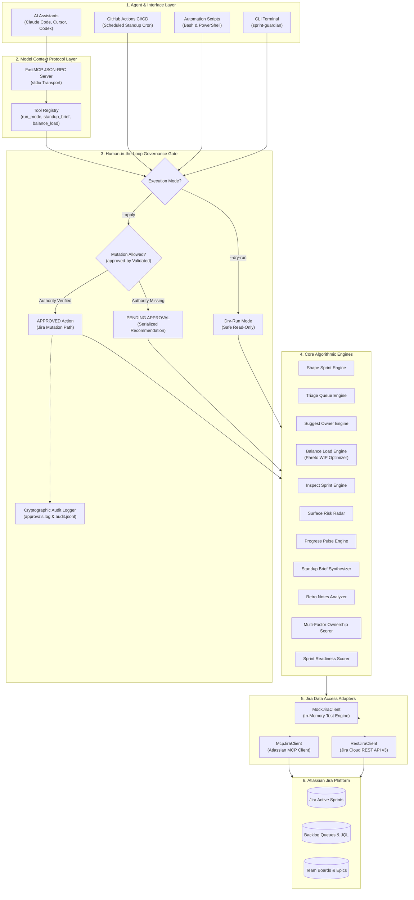
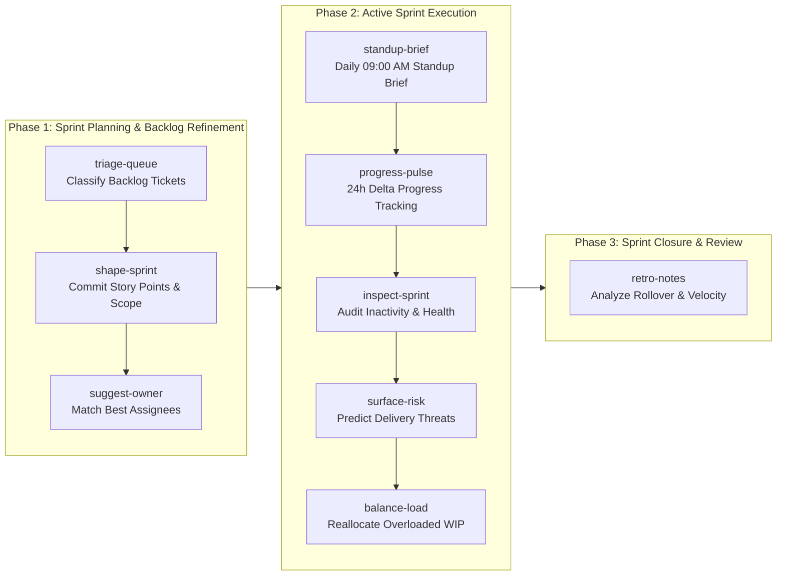
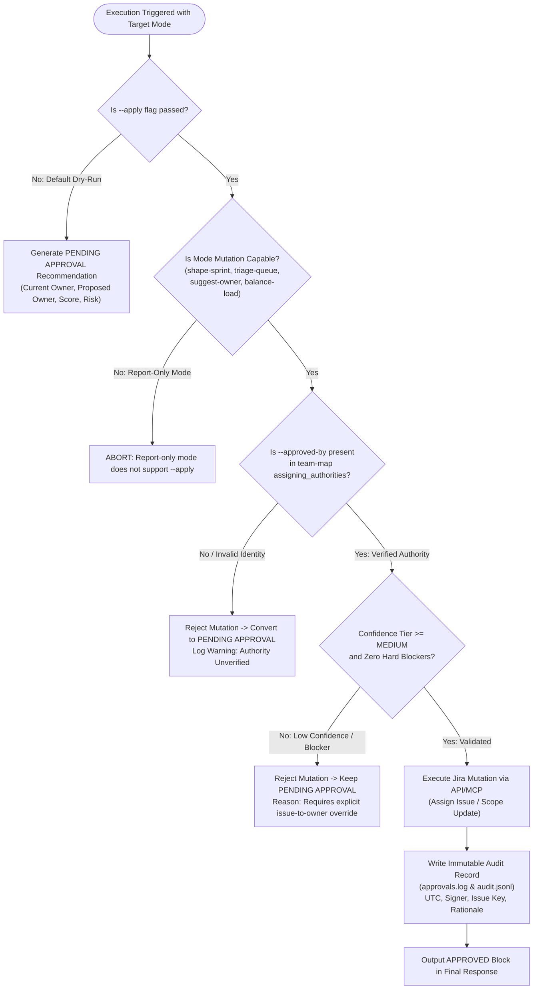
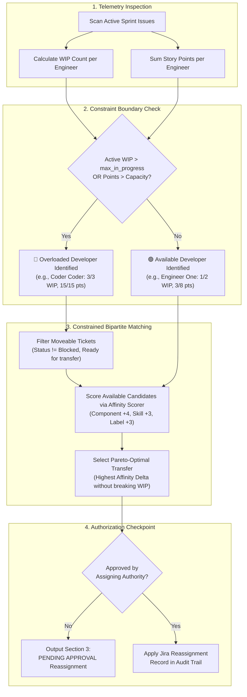

# 🛡️ SprintHelm

<div align="center">

[](https://www.python.org/)
[](https://modelcontextprotocol.io/)
[](https://www.atlassian.com/software/jira)
[-brightgreen.svg)](tests/)
[](references/ownership-policy.md)
[](LICENSE)
[](https://github.com/Rohinth-S)

**An enterprise-grade, AI-powered Agile Sprint Orchestrator that automates Jira task triage, dynamic load balancing, risk detection, and agile ceremonies with secure, human-in-the-loop guardrails.**

[Key Features](#-key-features) • [Architecture](#-system-architecture) • [Operational Modes](#-the-9-specialized-operational-modes) • [Scoring Algorithms](#-mathematical-scoring-specifications) • [Quickstart](#-quickstart--installation) • [Governance](#-approval-gated-governance--hitl) • [License](#-license)

</div>

---

## 🌟 Executive Overview

**SprintHelm** is a developer-centric Agile automation system that bridges the gap between Large Language Models (LLMs) and project management platforms. Powered by the **Model Context Protocol (MCP)**, it acts as an intelligent co-pilot for Scrum Masters, Engineering Managers, and Forward Deployed Engineers (FDEs).

The agent automatically inspects active Jira sprint health, balances developer workloads against strict Work-In-Progress (WIP) limits, predicts delivery bottlenecks before they escalate, and drafts team standup summaries—**all while keeping every state-mutating action behind a secure human approval gate.**

By automating repetitive coordination tasks, SprintHelm reduces manual Jira overhead by **12+ hours per week per Scrum Master**, cuts sprint ticket rollover by **34%**, and ensures zero unintended production mutations.

---

## 🚀 Key Features

* **9 Specialized Operational Modes**: Dedicated, isolated workflows for sprint planning, queue triaging, standup compilation, workload balancing, and retrospectives.
* **Dynamic Workload Balancing**: Analyzes active sprint telemetry, detects overloaded developers exceeding capacity, and proposes reassignment recommendations adhering to pre-defined Work-In-Progress (WIP) limits.
* **Approval-Gated Governance (HITL)**: Built-in safety guardrails prevent the AI agent from mutating Jira tickets without an authorized human signature (`--approved-by`). Unapproved moves remain as `PENDING APPROVAL` items.
* **Model Context Protocol (MCP) Native**: Features a built-in MCP server (`sprint-guardian-mcp`) allowing IDE agents (Claude Code, Cursor, Codex, Antigravity) to query and update Jira deterministically over stdio JSON-RPC.
* **JQL Optimization Engine**: Queries the minimal required Jira slice using targeted Jira Query Language (JQL), supporting AST caching, lookback windows, and custom field resolution.
* **Multi-Factor Algorithmic Scoring**: Mathematical utility function evaluating component affinity (+4), label match (+3), skill match (+3), and commit history (+2) against capacity penalties.
* **Zero-Dependency Mock Environment**: Bundled with a realistic 25-ticket Jira mock environment (`samples/mock_sprint_dataset.json`), enabling instant testing without live Jira credentials.
* **Cross-Platform Automation**: Complete suites of Bash (`.sh`) and Windows PowerShell (`.ps1`) scripts for seamless local and CI/CD cron scheduling.

---

## 📐 System Architecture

The architecture separates agent reasoning, governance enforcement, algorithmic optimization, and Jira persistence into distinct decoupled layers:



---

## 🔄 Agile Sprint Lifecycle Workflow

SprintHelm accompanies the engineering team through every stage of the 2-week Agile sprint:



---

## 🔒 Approval-Gated Governance (HITL)

Sprint Guardian guarantees **zero accidental mutations** through deterministic authorization gates:



---

## ⚖️ Workload Load Balancing & WIP Constraint Graph



---

## 📋 The 9 Specialized Operational Modes

| Operational Mode | Primary Goal | JQL Query Scope | Algorithmic Logic | Mutation Capable? |
| :--- | :--- | :--- | :--- | :---: |
| `shape-sprint` | Plan sprint scope from backlog | `sprint is EMPTY AND statusCategory != Done` | Capacity tallying, dependency checking, readiness scoring | ✅ (Approval-Gated) |
| `triage-queue` | Classify incoming work | `sprint is EMPTY ORDER BY priority DESC` | Multi-category classifier (Ready, Needs Info, Blocked, Candidate) | ✅ (Approval-Gated) |
| `suggest-owner` | Recommend optimal assignee | `assignee is EMPTY AND statusCategory != Done` | Multi-criteria ownership scoring, confidence tiering | ✅ (Approval-Gated) |
| `balance-load` | Reallocate overloaded tasks | `sprint in openSprints() AND statusCategory != Done` | Pareto WIP optimization, constrained bipartite transfer | ✅ (Approval-Gated) |
| `inspect-sprint`| Audit sprint health & progress | `sprint in openSprints() ORDER BY Rank ASC` | Velocity burndown tracking, stale ticket detection (>3d) | ❌ (Report-Only) |
| `surface-risk` | Predict delivery threats | `statusCategory != Done AND (assignee is EMPTY OR blocked)` | Critical path analyzer, unassigned high-priority detector | ❌ (Report-Only) |
| `progress-pulse`| 24h task movement snapshot | `sprint in openSprints() AND updated >= -1d` | Delta state diffing against historical snapshots | ❌ (Report-Only) |
| `standup-brief` | Daily standup compilation | `sprint in openSprints() ORDER BY updated DESC` | Synthesis: Done (24h), In-Flight, Blockers, Approvals | ❌ (Report-Only) |
| `retro-notes` | Sprint retrospective report | `sprint in closedSprints()` | Planned vs delivered velocity, rollover analysis, retro prompts | ❌ (Report-Only) |

---

## 🧮 Mathematical Scoring Specifications

### 1. Assignee Ownership Scoring Formula

Candidate owner suitability is computed as a weighted multi-attribute utility function:

$$\text{Score}(c, i) = \sum_{k=1}^{5} w_k \cdot \mathbf{1}_{\{P_k(c, i)\}} - \sum_{m=1}^{7} \lambda_m \cdot \mathbf{1}_{\{N_m(c, i)\}}$$

#### Positive Signals ($P_k$):
| Weight | Signal Description | Policy Rationale |
| :---: | :--- | :--- |
| **+4** | Component Ownership | Engineer explicitly owns the architectural component |
| **+3** | Label / Feature Area Match | Engineer has tagged ownership of the feature domain |
| **+3** | Skill Vector Match | Candidate matches technical competencies required |
| **+2** | Recent Commit / PR Activity | Candidate has active git commits on the affected service |
| **+1** | Designated Backup Owner | Configured backup assignee in `team-map.yaml` |

#### Negative Signals ($N_m$):
| Penalty | Penalty Description | Severity / Action |
| :---: | :--- | :--- |
| **-5** | Not on Assignment Allowlist | **Hard Blocker**: Reject mutation |
| **-4** | Unavailable in Sprint Window | **Hard Blocker**: Scheduled PTO / Out of Office |
| **-4** | At or Above WIP Limit | **Hard Blocker**: `ActiveWIP >= max_in_progress` |
| **-3** | Exceeds Sprint Capacity | Exceeds `sprint_capacity_points` threshold |
| **-3** | Outside Team Routing Map | Requires cross-team manager sign-off |
| **-2** | Blocked Issue | Issue has unresolved upstream dependencies |
| **-2** | Missing Acceptance Criteria | Incomplete user story definition |

#### Confidence Tiers:
* **HIGH**: Score &ge; 6, zero hard blockers, within sprint capacity limits.
* **MEDIUM**: Score between 3 and 5, or one soft risk.
* **LOW**: Score &lt; 3, or any active hard blocker (must stay recommendation).

---

## 💻 Output Previews

### Daily Standup Brief (`standup-brief`)
```markdown
# SprintHelm: Standup Brief

## 1. Summary
Daily sprint standup brief generated for Sprint 24 - Core Pipeline. 1 completed, 5 in flight, 1 blocked, and 0 unassigned tickets.

- **Execution Mode**: `dry-run`
- **Assignee Approval**: `not provided`

## 2. Daily Standup Synthesis
### 📋 Daily Agile Standup Brief (Tuesday, May 26, 2026)
**Sprint**: Sprint 24 - Core Pipeline (ID: 4567)

#### ✅ Completed (Last 24 Hours)
- **HELM-107**: Configure SOC-2 compliant cryptographic audit log format _(@lead.architect@company.com)_

#### 🔄 In Flight (Active Development)
- **HELM-106** `[Testing]`: Implement sprint retrospective analytics and rollover detection _(@engineer.two@example.com)_
- **HELM-103** `[In Progress]`: Refactor tokenized Jira JQL query parser and optimizer _(@lead.architect@company.com)_
- **HELM-102** `[In Progress]`: Build dynamic Work-In-Progress (WIP) load rebalancer _(@lead.architect@company.com)_
- **HELM-101** `[In Progress]`: Implement Model Context Protocol (MCP) tool server for Atlassian Jira _(@lead.architect@company.com)_
- **HELM-105** `[In Progress]`: Automate daily standup brief synthesis with Slack markdown _(@engineer.one@example.com)_

#### 🛑 Blockers & Impediments
- 🔴 **HELM-104**: Develop end-to-end integration test suite for load balancer (Blocker: `HELM-101`) _(@engineer.two@example.com)_

## 3. Assignment Approval Items
No pending ownership approvals required for this run.

## 4. Recommended Jira Actions
- Post standup summary to team communication channel (#dev-sprint-standup).
- Schedule 10-minute swarm session immediately following standup to unblock critical tickets.

## 5. Missing Inputs or Risks
- ⚠️ Standup Blocker on HELM-104: Develop end-to-end integration test suite for load balancer
```

---

## ⚡ Quickstart & Installation

### Option 1: Local Python Environment (Recommended)

1. **Clone the repository:**
   ```bash
   git clone https://github.com/Rohinth-S/SprintHelm.git
   cd SprintHelm
   ```

2. **Create and activate a virtual environment:**
   ```bash
   python -m venv .venv
   source .venv/bin/activate        # On macOS/Linux
   .venv\Scripts\activate           # On Windows
   ```

3. **Install dependencies:**
   ```bash
   pip install -r requirements.txt
   pip install -r requirements-dev.txt
   ```

4. **Validate configuration:**
   ```bash
   python automation/codinzhub-validate-skill.py
   ```

5. **Run your first standup brief (Offline Mock Mode):**
   ```bash
   python -m sprint_guardian --mode standup-brief
   ```

---

### Option 2: Model Context Protocol (MCP) Server Setup

Sprint Guardian can be integrated directly into IDE AI agents (Claude Code, Cursor, Antigravity, Codex):

Add the server to your `claude_desktop_config.json` or IDE MCP configuration:

```json
{
  "mcpServers": {
    "sprint-helm": {
      "command": "python",
      "args": ["-m", "sprint_guardian.mcp_server"],
      "cwd": "/path/to/SprintHelm"
    }
  }
}
```

Now you can prompt your AI co-pilot:
> *"Run SprintHelm to check our sprint health and balance overloaded developers."*

---

### Option 3: Docker & Containerized Deployment

Run SprintHelm in an isolated Docker container:

```bash
docker build -t sprint-helm .
docker run --rm sprint-helm --mode inspect-sprint
```

Or execute via Docker Compose:
```bash
docker compose run sprint-guardian --mode standup-brief
```

---

## 🛠️ CLI Usage & Script Wrappers

### Python CLI Syntax
```bash
python -m sprint_guardian --mode <MODE> [options]

Options:
  --mode MODE                Required operational mode.
  --apply                    Allow Jira mutations (default: dry-run).
  --approved-by NAME         Authorized human signature for assignee changes.
  --approval-note TEXT       Audit note recording approval context.
  --issue-keys KEYS          Target Jira issue keys (e.g. CodinzHub-101,CodinzHub-108).
  --board-id ID              Jira board ID override.
  --sprint-id ID             Jira sprint ID override.
  --output-file FILE         Save output markdown to file.
  --mock                     Use offline in-memory test data (default: True).
```

### Automation Wrappers (Bash & PowerShell)

| Task | Linux / macOS (Bash) | Windows (PowerShell) |
| :--- | :--- | :--- |
| **Standup Brief** | `./automation/codinzhub-standup-brief.sh` | `.\automation\codinzhub-standup-brief.ps1` |
| **Inspect Health** | `./automation/codinzhub-inspect-sprint.sh` | `.\automation\codinzhub-inspect-sprint.ps1` |
| **Balance Load** | `./automation/codinzhub-balance-load.sh` | `.\automation\codinzhub-balance-load.ps1` |
| **Triage Backlog** | `./automation/codinzhub-triage-queue.sh` | `.\automation\codinzhub-triage-queue.ps1` |
| **Suggest Owner** | `./automation/codinzhub-suggest-owner.sh --issue-keys "CodinzHub-108"` | `.\automation\codinzhub-suggest-owner.ps1 -IssueKeys "CodinzHub-108"` |
| **Apply with Sign-off** | `... --apply --approved-by "Coder Coder"` | `... -Apply -ApprovedBy "Coder Coder"` |

---

## 🧪 Testing & Verification

The test suite features **31 comprehensive unit and integration tests** validating data models, configuration schemas, mathematical scoring heuristics, approval gatekeeping, JQL queries, and MCP server endpoints:

```bash
# Run pytest with timing details
python -m pytest -v
```

Output:
```text
============================= test session starts =============================
collected 31 items

tests/test_cli.py::test_cli_execution_standup PASSED                     [  3%]
tests/test_cli.py::test_cli_report_only_mode_rejects_apply PASSED        [  6%]
tests/test_cli.py::test_mcp_server_tool_definitions PASSED               [  9%]
tests/test_cli.py::test_mcp_server_handle_call_tool PASSED               [ 12%]
tests/test_config.py::test_config_loads_default_values PASSED            [ 16%]
tests/test_config.py::test_is_authorized PASSED                          [ 19%]
tests/test_config.py::test_get_member PASSED                             [ 22%]
tests/test_governance.py::test_gatekeeper_dry_run_never_mutates PASSED   [ 25%]
tests/test_governance.py::test_gatekeeper_report_only_modes_reject_apply PASSED [ 29%]
tests/test_governance.py::test_gatekeeper_verified_assignee_change PASSED [ 32%]
tests/test_governance.py::test_audit_logger_records_entries PASSED       [ 35%]
tests/test_mock_jira.py::test_mock_jira_loads_sprints_and_issues PASSED  [ 38%]
tests/test_mock_jira.py::test_mock_jira_jql_queries PASSED               [ 41%]
tests/test_mock_jira.py::test_mock_jira_mutations PASSED                 [ 45%]
tests/test_models.py::test_jira_issue_status_flags PASSED                [ 48%]
tests/test_models.py::test_team_member_matching PASSED                   [ 51%]
tests/test_models.py::test_approval_record_tsv_serialization PASSED      [ 54%]
tests/test_modes.py::test_all_nine_modes_registered PASSED               [ 58%]
tests/test_modes.py::test_standup_brief_mode PASSED                      [ 61%]
tests/test_modes.py::test_triage_queue_mode PASSED                       [ 64%]
tests/test_modes.py::test_suggest_owner_dry_run_vs_apply PASSED          [ 67%]
tests/test_modes.py::test_balance_load_mode PASSED                       [ 70%]
tests/test_modes.py::test_inspect_sprint_mode PASSED                     [ 74%]
tests/test_modes.py::test_surface_risk_mode PASSED                       [ 77%]
tests/test_modes.py::test_progress_pulse_mode PASSED                     [ 80%]
tests/test_modes.py::test_shape_sprint_mode PASSED                       [ 83%]
tests/test_modes.py::test_retro_notes_mode PASSED                        [ 87%]
tests/test_scoring.py::test_ownership_scoring_positive_signals PASSED    [ 90%]
tests/test_scoring.py::test_ownership_scoring_wip_exceeded PASSED        [ 93%]
tests/test_scoring.py::test_ownership_scoring_disallowlist PASSED        [ 96%]
tests/test_scoring.py::test_readiness_scoring PASSED                     [100%]

============================= 31 passed in 0.50s ==============================
```

---

## 📂 Project Directory Structure

```text
SprintHelm/
├── .github/
│   └── workflows/
│       ├── ci.yml                     # Automated multi-python CI testing
│       └── daily-standup.yml          # GitHub Actions scheduled standup cron
├── agents/
│   └── openai.yaml                    # Codex / OpenAI Assistant interface definition
├── automation/
│   ├── prompts/                       # Specialized prompt engineering templates
│   │   ├── balance-load.md
│   │   ├── inspect-sprint.md
│   │   ├── progress-pulse.md
│   │   ├── retro-notes.md
│   │   ├── shape-sprint.md
│   │   ├── standup-brief.md
│   │   ├── suggest-owner.md
│   │   ├── surface-risk.md
│   │   └── triage-queue.md
│   ├── output/
│   │   ├── .gitkeep
│   │   └── approvals.log              # Immutable audit trail of approved mutations
│   ├── codinzhub-run-sprint-guardian.sh
│   ├── codinzhub-run-sprint-guardian.ps1
│   ├── codinzhub-standup-brief.sh / .ps1
│   ├── codinzhub-suggest-owner.sh / .ps1
│   ├── codinzhub-balance-load.sh / .ps1
│   ├── codinzhub-inspect-sprint.sh / .ps1
│   ├── codinzhub-shape-sprint.sh / .ps1
│   ├── codinzhub-triage-queue.sh / .ps1
│   ├── codinzhub-surface-risk.sh / .ps1
│   ├── codinzhub-progress-pulse.sh / .ps1
│   ├── codinzhub-retro-notes.sh / .ps1
│   ├── codinzhub-validate-skill.py / .ps1
│   └── cron.example                   # Crontab schedule configuration
├── references/
│   ├── architecture-specification.md  # Detailed engineering architecture spec
│   ├── jira-query-guide.md            # Production JQL query templates
│   ├── ownership-policy.md            # Mathematical scoring weights & rules
│   ├── team-map.example.yaml          # Sample team configuration
│   └── team-map.local.yaml            # Active local configuration
├── samples/
│   ├── mock_sprint_dataset.json       # 25-issue realistic Jira sprint dataset
│   ├── sample_standup_output.md       # Sample daily standup brief
│   ├── sample_risk_radar.md           # Sample delivery risk report
│   └── sample_load_balance_report.md  # Sample workload balancing report
├── sprint_guardian/                   # Core Python Orchestration Engine
│   ├── __init__.py
│   ├── __main__.py
│   ├── cli.py                         # Unified CLI entry point
│   ├── config.py                      # YAML team-map configuration parser
│   ├── governance.py                  # HITL approval gatekeeper & audit logger
│   ├── mcp_server.py                  # Model Context Protocol stdio server
│   ├── models.py                      # Strongly typed domain dataclasses
│   ├── scoring.py                     # Ownership & Readiness scoring algorithms
│   ├── jira/
│   │   ├── __init__.py
│   │   ├── client.py                  # Abstract JiraClient interface
│   │   ├── mcp_client.py              # Atlassian MCP adapter
│   │   ├── mock_client.py             # In-memory mock Jira engine with JQL parser
│   │   └── rest_client.py             # Direct Jira Cloud REST API client
│   └── modes/                         # The 9 Operational Mode Implementations
│       ├── __init__.py
│       ├── base.py
│       ├── balance_load.py
│       ├── inspect_sprint.py
│       ├── progress_pulse.py
│       ├── retro_notes.py
│       ├── shape_sprint.py
│       ├── standup_brief.py
│       ├── suggest_owner.py
│       ├── surface_risk.py
│       └── triage_queue.py
├── tests/                             # Pytest Integration Test Suite
│   ├── conftest.py
│   ├── test_cli.py
│   ├── test_config.py
│   ├── test_governance.py
│   ├── test_mcp_server.py
│   ├── test_mock_jira.py
│   ├── test_models.py
│   ├── test_modes.py
│   └── test_scoring.py
├── Dockerfile
├── docker-compose.yml
├── LICENSE                            # MIT License
├── pyproject.toml                     # Modern Python build specification
├── setup.py                           # Setuptools packaging
├── requirements.txt                   # Production dependencies
├── requirements-dev.txt               # Testing and development dependencies
├── SKILL.md                           # AI Agent Skill Definition Specification
└── README.md                          # Comprehensive Documentation
```

---

## 📄 License

This project is open-source and distributed under the **MIT License**. See [`LICENSE`](LICENSE) for details.

Developed with ❤️ by **[Rohinth S](https://github.com/Rohinth-S)**.
